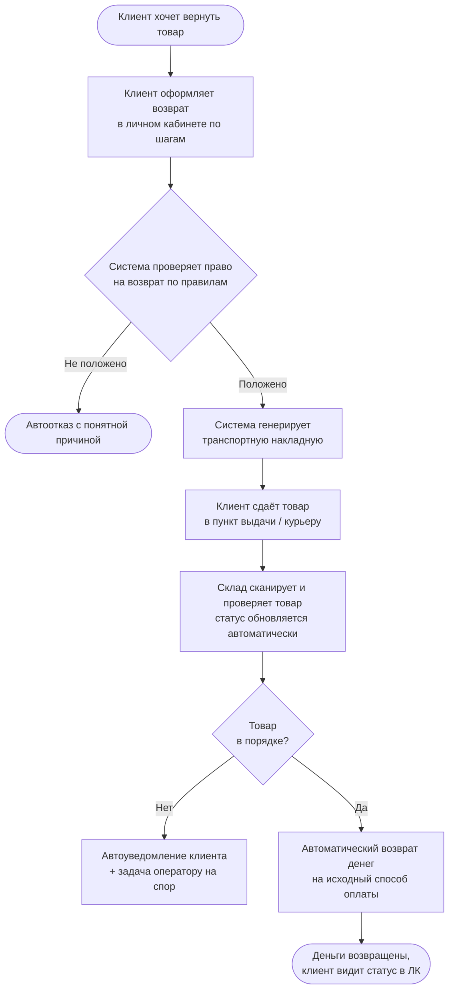

# Кейс 1. Оптимизация процесса возврата товара в интернет-магазине

Домен: e-commerce. В этом кейсе я моделирую процесс в BPMN, докапываюсь до причин проблемы и считаю, что даст его переделка.

---

## С чего всё началось

Интернет-магазин одежды «МаркетЛайн» (условный) обрабатывает около 1 200 возвратов в месяц. Процесс ручной от начала до конца: клиент пишет в поддержку, оператор ищет заказ, стороны пару раз переписываются, заявка живёт в Excel, деньги возвращает бухгалтерия руками.

Пришли с тремя жалобами:

- деньги возвращаются в среднем за 14 дней, из-за этого растёт негатив в отзывах;
- 42% обращений в поддержку — это возвраты и вопрос «где мои деньги?»;
- заявки теряются, деньги уходят не на ту карту, бывают двойные возвраты.

Моя задача: восстановить процесс как есть, найти, где он буксует и почему, предложить новый вариант и посчитать эффект.

---

## Процесс AS-IS («как есть»)

Модель процесса: [`diagrams/as-is.bpmn`](diagrams/as-is.bpmn) — открывается в Camunda Modeler или Bizagi. Та же логика в Mermaid ниже.

### Где процесс буксует

| # | Место | В чём затык | Что из-за этого |
|---|---|---|---|
| 1 | Обращение в свободной форме | Оператор переспрашивает заказ, причину, фото | Плюс день-два на переписку |
| 2 | Ручная проверка права на возврат | Оператор сам сверяет дату, категорию, состояние | Ошибки, неровная нагрузка |
| 3 | Заявки в Excel | Нет статусов и уведомлений, заявки теряются | Клиент не видит прогресс и пишет снова |
| 4 | Ручной возврат денег | Бухгалтерия обрабатывает партиями раз в неделю | Главная причина, почему возврат длится 14 дней |

---

## Почему так долго

Разбор причин — в [`docs/problem-analysis.md`](docs/problem-analysis.md): там «5 почему» и диаграмма Исикавы.

Если коротко: дело не в «медленной бухгалтерии». Долгий срок заложен в самом устройстве процесса — нет единой системы заявок, нет правил автопроверки, а возврат денег никак не связан с тем, что товар уже приняли на складе.

---

## Процесс TO-BE («как должно быть»)

Модель процесса: [`diagrams/to-be.bpmn`](diagrams/to-be.bpmn).

### Что поменялось

Клиент оформляет возврат сам в личном кабинете, а не через переписку — оператор нужен только на спорных кейсах. Право на возврат проверяет система по правилам (срок, категория, признак надлежащего качества), а не оператор вручную. Статус виден клиенту, поэтому он не пишет повторно. Деньги возвращаются сразу после того, как товар приняли на складе, а не раз в неделю партией из бухгалтерии.

---

## Что это даёт

Расчёт с допущениями — в [`docs/effect-estimation.md`](docs/effect-estimation.md).

| Метрика | AS-IS | TO-BE (цель) | Эффект |
|---|---|---|---|
| Средний срок возврата денег | 14 дней | 4 дня | −71% |
| Доля обращений в поддержку про возвраты | 42% | ~15% | −27 п.п. |
| Ручных действий оператора на 1 возврат | ~6 | ~1 (только споры) | −80% |
| Экономия на поддержке | — | ~580 тыс. ₽/год | см. расчёт |

---

## Стек

`BPMN 2.0` · `Camunda Modeler` · `Mermaid` · «5 почему» · диаграмма Исикавы · оценка эффекта.

Процесс AS-IS я восстановил по разговорам с поддержкой и складом (в учебном кейсе — по сценарию), отметил на нём узкие места, через «5 почему» и Исикаву дошёл до причин. В TO-BE закрывал именно причины, а не симптомы, и в конце перевёл результат в дни и деньги.
