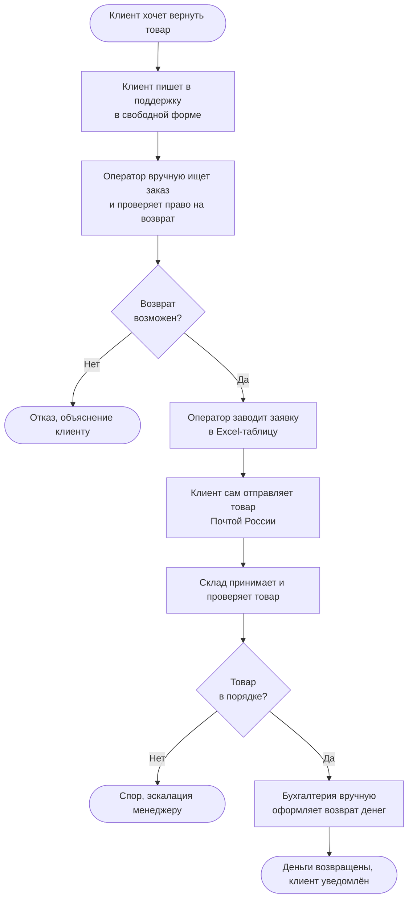

# Кейс 1. Оптимизация процесса возврата товара в интернет-магазине

**Роль:** бизнес-аналитик · **Домен:** e-commerce · **Что показывает кейс:** моделирование процессов в BPMN, анализ первопричин, структурное мышление, оценка эффекта.

---

## Бизнес-контекст и проблема

Интернет-магазин одежды «МаркетЛайн» (условный) получает в среднем **1 200 возвратов в месяц**. Процесс возврата полностью ручной: клиент пишет в поддержку, оператор проверяет заказ, стороны обмениваются сообщениями, заявка ведётся в Excel, деньги возвращает бухгалтерия вручную.

Симптомы, с которыми пришёл бизнес:

- средний срок возврата денег клиенту — **14 дней**, из-за этого растут жалобы и негатив в отзывах;
- **42%** обращений в поддержку связаны с возвратами и их статусом («где мои деньги?»);
- регулярные ошибки: потерянные заявки, возвраты не на ту карту, двойные возвраты.

**Задача аналитика:** разобрать процесс «как есть», найти узкие места и первопричины, предложить процесс «как должно быть» и оценить эффект.

---

## Процесс AS-IS («как есть»)

Файл модели: [`diagrams/as-is.bpmn`](diagrams/as-is.bpmn) (открывается в Camunda Modeler / Bizagi). Ниже — та же логика в Mermaid.

### Узкие места (bottlenecks)

| # | Узкое место | Почему тормозит | Последствие |
|---|---|---|---|
| 1 | Обращение в свободной форме | Оператор переспрашивает заказ, причину, фото | +1–2 дня на переписку |
| 2 | Ручная проверка права на возврат | Оператор сверяет дату, категорию, состояние вручную | Ошибки, неравномерная нагрузка |
| 3 | Заявки в Excel | Нет статусов, нет уведомлений, заявки теряются | Клиент не видит прогресс → пишет снова |
| 4 | Ручной возврат денег бухгалтерией | Партиями раз в неделю | Главный вклад в срок 14 дней |

---

## Анализ первопричин

Подробно — в [`docs/problem-analysis.md`](docs/problem-analysis.md): «5 почему» и диаграмма Исикавы.

Короткий вывод: длинный срок возврата — это не «ленивая бухгалтерия», а **следствие архитектуры процесса**: нет единой системы заявок, нет правил автопроверки, возврат денег не связан с фактом приёмки товара на складе.

---

## Процесс TO-BE («как должно быть»)

Файл модели: [`diagrams/to-be.bpmn`](diagrams/to-be.bpmn).

### Что изменилось

- **Самообслуживание в ЛК** вместо переписки — оператор подключается только к спорным кейсам.
- **Автопроверка права на возврат** по бизнес-правилам (срок, категория, признак «надлежащего качества») — вместо ручной сверки.
- **Единый статусный трекер** вместо Excel — клиент видит прогресс и не пишет повторно.
- **Автовозврат денег** сразу после приёмки товара на складе — вместо еженедельных партий в бухгалтерии.

---

## Оценка эффекта

Подробный расчёт с допущениями — в [`docs/effect-estimation.md`](docs/effect-estimation.md).

| Метрика | AS-IS | TO-BE (цель) | Эффект |
|---|---|---|---|
| Средний срок возврата денег | 14 дней | 4 дня | **−71%** |
| Доля обращений в поддержку про возвраты | 42% | ~15% | **−27 п.п.** |
| Ручных действий оператора на 1 возврат | ~6 | ~1 (только споры) | **−80%** |
| Оценочная экономия на поддержке | — | ~**580 тыс. ₽/год** | см. расчёт |

---

## Стек и ход работы

`BPMN 2.0` · `Camunda Modeler` · `Mermaid` · «5 почему» · диаграмма Исикавы · оценка эффекта по допущениям.

**Как я работал:** восстановил процесс AS-IS по интервью с поддержкой и складом (в учебном кейсе — по сценарию) → разметил узкие места → докопался до первопричин через «5 почему» и Исикаву → спроектировал TO-BE с устранением именно первопричин, а не симптомов → оцифровал эффект в деньгах и днях.
