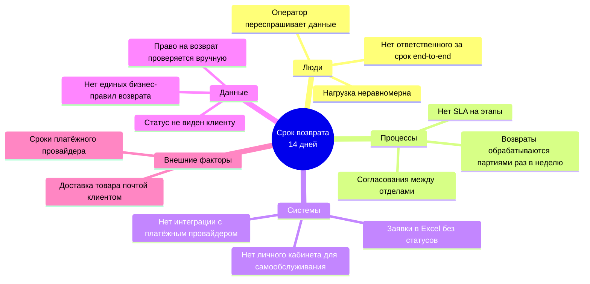

# Анализ первопричин: почему возврат денег занимает 14 дней

Цель анализа — не бороться с симптомом («ускорить бухгалтерию»), а найти корневую причину длинного срока возврата и устранить именно её в процессе TO-BE.

---

## «5 почему»

**Проблема:** деньги клиенту возвращаются в среднем за 14 дней, что порождает жалобы и повторные обращения.

1. **Почему так долго?** — Бухгалтерия оформляет возвраты денег партиями раз в неделю, поэтому заявка ждёт своей «партии».
2. **Почему партиями, а не сразу?** — Каждый возврат бухгалтер оформляет вручную в платёжной системе; пакетная обработка — способ сэкономить время на рутине.
3. **Почему вручную?** — Нет интеграции между местом, где ведутся заявки, и платёжным провайдером. Более того, единого места для заявок нет — они в Excel.
4. **Почему нет системы заявок и интеграции?** — Возврат исторически считался редким краевым сценарием, на автоматизацию которого «не доходили руки».
5. **Почему до сих пор не пересмотрели приоритет?** — У процесса нет владельца и нет сквозной метрики срока возврата. Поддержка отвечает за переписку, склад — за приёмку, бухгалтерия — за платёж, но никто не отвечает за срок *end-to-end*.

**Корневая причина:** отсутствие владельца процесса и сквозной автоматизации «заявка → приёмка → возврат денег». Срок в 14 дней — закономерный итог раздробленного ручного процесса, а не вина отдельного отдела.

---

## Диаграмма Исикавы («рыбий скелет»)

Факторы, влияющие на длительный срок возврата, сгруппированы по категориям.

---

## Вывод для проектирования TO-BE

Чтобы сократить срок, в процессе TO-BE нужно закрыть именно корневые факторы:

| Корневой фактор | Решение в TO-BE |
|---|---|
| Нет единого места заявок со статусами | Личный кабинет + статусный трекер |
| Ручная проверка права на возврат | Бизнес-правила и автопроверка |
| Возврат денег оторван от факта приёмки | Автовозврат по событию «товар принят на складе» |
| Нет владельца и метрики | Назначить владельца процесса, ввести метрику «срок возврата» |

Симптоматические меры (нанять ещё бухгалтера, просить обрабатывать чаще) дали бы разовый эффект, но не устранили бы причину. Поэтому ставка сделана на изменение архитектуры процесса.
