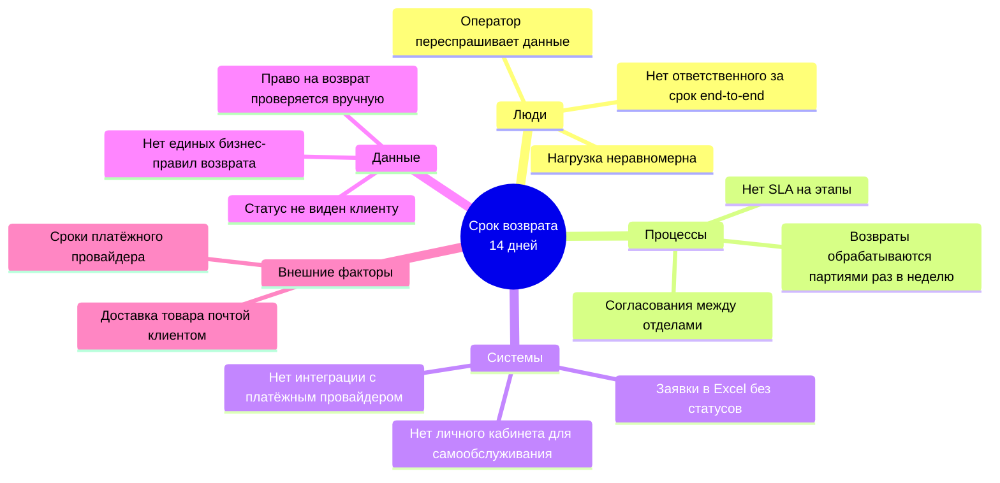

# Почему возврат денег занимает 14 дней

Цель разбора — не ускорить бухгалтерию (это лечение симптома), а найти причину долгого срока и убрать её в новом процессе.

---

## «5 почему»

Проблема: деньги клиенту возвращаются в среднем за 14 дней, из-за этого растут жалобы и повторные обращения.

1. Почему так долго? Бухгалтерия оформляет возвраты партиями раз в неделю, и заявка ждёт своей партии.
2. Почему партиями? Каждый возврат бухгалтер вбивает в платёжную систему вручную, а пакетом это делать быстрее.
3. Почему вручную? Нет связки между тем, где лежат заявки, и платёжным провайдером. Да и самих заявок как системы нет — они в Excel.
4. Почему нет системы и интеграции? Возврат долго считали редким случаем, до автоматизации которого руки не доходили.
5. Почему приоритет так и не пересмотрели? У процесса нет хозяина и нет сквозной метрики срока. Поддержка отвечает за переписку, склад за приёмку, бухгалтерия за платёж, а за срок от начала до конца не отвечает никто.

Вывод: корень — в том, что у процесса нет владельца и нет сквозной автоматизации «заявка → приёмка → возврат денег». 14 дней это закономерный итог раздробленного ручного процесса, а не вина одного отдела.

---

## Диаграмма Исикавы

Факторы, которые влияют на срок возврата, по категориям.

---

## Что из этого следует для TO-BE

В новом процессе я закрываю именно корневые факторы:

| Корневой фактор | Решение в TO-BE |
|---|---|
| Нет единого места заявок со статусами | Личный кабинет и статусный трекер |
| Ручная проверка права на возврат | Бизнес-правила и автопроверка |
| Возврат денег оторван от факта приёмки | Автовозврат по событию «товар принят на складе» |
| Нет владельца и метрики | Назначить владельца процесса, завести метрику срока возврата |

Нанять ещё одного бухгалтера или просить обрабатывать чаще — это разовый эффект, причина никуда не денется. Поэтому меняю устройство процесса, а не наращиваю ручной труд.
