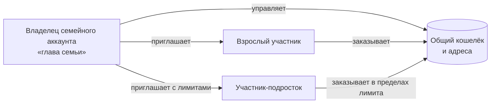
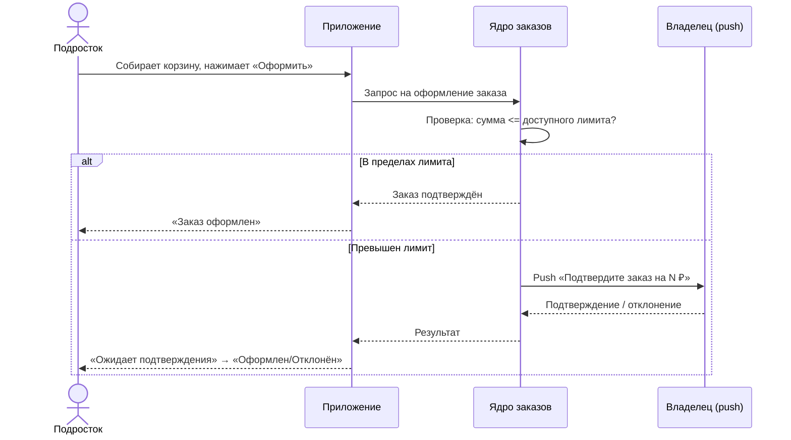

# Кейс 2. Требования к фиче «Семейный аккаунт» для сервиса доставки продуктов

**Роль:** бизнес-аналитик · **Домен:** e-commerce / доставка · **Что показывает кейс:** полный цикл работы с требованиями — главный навык BA: от стейкхолдеров и персон до user stories с критериями приёмки, use cases и приоритизации.

---

## Бизнес-контекст

Сервис доставки продуктов «СвежоДоставка» (условный) заметил, что одним аккаунтом часто пользуется вся семья: заказы оформляются с одного телефона, но адреса, оплата и состав корзины у членов семьи разные. Это рождает проблемы: ребёнок не может заказать сам, нельзя разделить оплату, глава семьи не контролирует траты, история заказов «общая каша».

**Гипотеза продукта:** если дать семьям официальный «Семейный аккаунт» с общими адресами, оплатой и ролями, вырастут частота заказов и удержание, а нагрузка на поддержку по «чужим заказам» снизится.

**Задача аналитика:** проработать фичу от начала до конца — кто стейкхолдеры, какие роли у пользователей, какие именно требования, что в первой версии, а что потом, и как мы поймём, что фича успешна.

---

## Документы кейса

| Документ | Что внутри |
|---|---|
| [docs/stakeholders.md](docs/stakeholders.md) | Карта стейкхолдеров, матрица «влияние/интерес», RACI, персоны пользователей |
| [docs/requirements.md](docs/requirements.md) | Бизнес-требования (BRD), функциональные и нефункциональные требования, user stories с критериями приёмки, приоритизация MoSCoW |
| [docs/use-cases.md](docs/use-cases.md) | Сценарии использования + sequence-диаграмма |
| [docs/glossary.md](docs/glossary.md) | Глоссарий предметной области |

---

## Роли внутри семейного аккаунта

- **Владелец** — создаёт аккаунт, приглашает участников, задаёт лимиты, управляет общим кошельком и способами оплаты.
- **Взрослый участник** — полноценно заказывает, пользуется общими адресами и оплатой.
- **Участник-подросток** — заказывает в пределах лимита и/или с подтверждением владельца.

---

## Границы первой версии (MoSCoW, кратко)

| Must have | Should have | Could have | Won't have (в v1) |
|---|---|---|---|
| Создание семейного аккаунта, приглашение/удаление участников, общие адреса, общая оплата, роли | Лимиты трат для подростков, подтверждение заказа владельцем | Общий список покупок, уведомления «кто-то заказал» | Раздельные счета-выписки, интеграция с банковскими семейными картами |

Полная таблица с обоснованием — в [requirements.md](docs/requirements.md#приоритизация-moscow).

---

## Ключевой сценарий (Use Case 2: заказ подростком с лимитом)

---

## Как поймём, что фича успешна (метрики)

| Метрика | Базовая гипотеза | Как измерим |
|---|---|---|
| Доля аккаунтов, подключивших семью | — | % аккаунтов с ≥2 участниками через 3 мес |
| Частота заказов (на аккаунт) | рост на 15% | сравнение с контрольной группой |
| Retention семейных аккаунтов | выше на 10 п.п. | когорты «семейные vs обычные» |
| Обращения «чужой заказ / не та оплата» | снижение на 30% | теги обращений в поддержке |

Подробнее — в [requirements.md](docs/requirements.md#метрики-успеха).

---

## Стек и ход работы

`Карта стейкхолдеров` · `RACI` · `Персоны` · `BRD` · `User stories (INVEST)` · `Критерии приёмки Given/When/Then` · `Use cases` · `UML sequence` · `MoSCoW`

**Как я работал:** определил стейкхолдеров и их интересы (в т.ч. противоречащие: финансы хотят общий кошелёк, юристы — согласие на обработку данных членов семьи) → описал персоны и их задачи (JTBD) → сформулировал бизнес-требования и декомпозировал их в user stories с проверяемыми критериями приёмки → зафиксировал нефункциональные требования (безопасность, 152-ФЗ, производительность) → приоритизировал по MoSCoW, явно отрезав v1 → задал метрики успеха.
