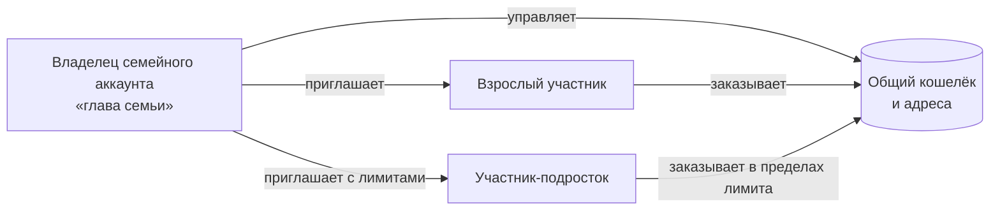
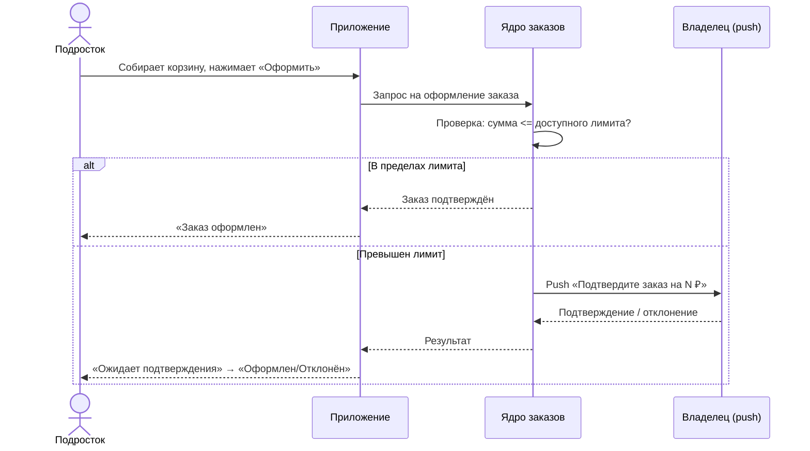

# Кейс 2. Требования к фиче «Семейный аккаунт» для сервиса доставки продуктов

Домен: доставка продуктов. Здесь я прохожу весь путь работы с требованиями — от стейкхолдеров и персон до user stories с критериями приёмки, use cases и приоритизации. Это и есть главное, что делает бизнес-аналитик.

---

## Контекст

Сервис доставки продуктов «СвежоДоставка» (условный) заметил, что одним аккаунтом часто пользуется вся семья: заказы идут с одного телефона, а адреса, оплата и состав корзины у всех разные. Отсюда проблемы: ребёнок не может заказать сам, оплату не разделить, глава семьи не видит трат, история заказов превращается в кашу.

Гипотеза продукта: если дать семьям нормальный «Семейный аккаунт» с общими адресами, оплатой и ролями, вырастут частота заказов и удержание, а поддержку перестанут заваливать вопросами про чужие заказы.

Моя задача — проработать фичу целиком: кто стейкхолдеры, какие роли у пользователей, какие именно требования, что входит в первую версию, а что нет, и как мы поймём, что всё сработало.

---

## Документы кейса

| Документ | Что внутри |
|---|---|
| [docs/stakeholders.md](docs/stakeholders.md) | Карта стейкхолдеров, матрица «влияние/интерес», RACI, персоны |
| [docs/requirements.md](docs/requirements.md) | Бизнес-требования (BRD), функциональные и нефункциональные требования, user stories с критериями приёмки, приоритизация MoSCoW |
| [docs/use-cases.md](docs/use-cases.md) | Сценарии использования и sequence-диаграмма |
| [docs/glossary.md](docs/glossary.md) | Глоссарий предметной области |

---

## Роли внутри семейного аккаунта

Владелец создаёт аккаунт, приглашает участников, задаёт лимиты, управляет общим кошельком и способами оплаты. Взрослый участник заказывает без ограничений, пользуясь общими адресами и оплатой. Подросток заказывает в пределах лимита, а сверх него — с подтверждением владельца.

---

## Что входит в первую версию (MoSCoW, кратко)

| Must have | Should have | Could have | Won't have (в v1) |
|---|---|---|---|
| Создание аккаунта, приглашение/удаление участников, общие адреса, общая оплата, роли | Лимиты трат для подростков, подтверждение заказа владельцем | Общий список покупок, уведомления «кто-то заказал» | Раздельные счета-выписки, интеграция с банковскими семейными картами |

Полная таблица с обоснованием — в [requirements.md](docs/requirements.md#приоритизация-moscow).

---

## Ключевой сценарий (Use Case 2: заказ подростком с лимитом)

---

## Как поймём, что фича сработала

| Метрика | Гипотеза | Как измерим |
|---|---|---|
| Доля аккаунтов, подключивших семью | — | % аккаунтов с ≥2 участниками через 3 мес |
| Частота заказов на аккаунт | рост на 15% | сравнение с контрольной группой |
| Retention семейных аккаунтов | выше на 10 п.п. | когорты «семейные vs обычные» |
| Обращения «чужой заказ / не та оплата» | снижение на 30% | теги обращений в поддержке |

Подробнее — в [requirements.md](docs/requirements.md#метрики-успеха).

---

## Стек

`Карта стейкхолдеров` · `RACI` · `Персоны` · `BRD` · `User stories (INVEST)` · `Критерии приёмки Given/When/Then` · `Use cases` · `UML sequence` · `MoSCoW`

Сначала я определил стейкхолдеров и их интересы, в том числе конфликтующие: финансам нужен общий кошелёк, юристам — согласие на обработку данных членов семьи. Описал персоны и их задачи, разложил бизнес-требования на user stories с проверяемыми критериями приёмки, зафиксировал нефункциональные требования (безопасность, 152-ФЗ, скорость), приоритизировал по MoSCoW и явно отрезал первую версию, а в конце задал метрики.
