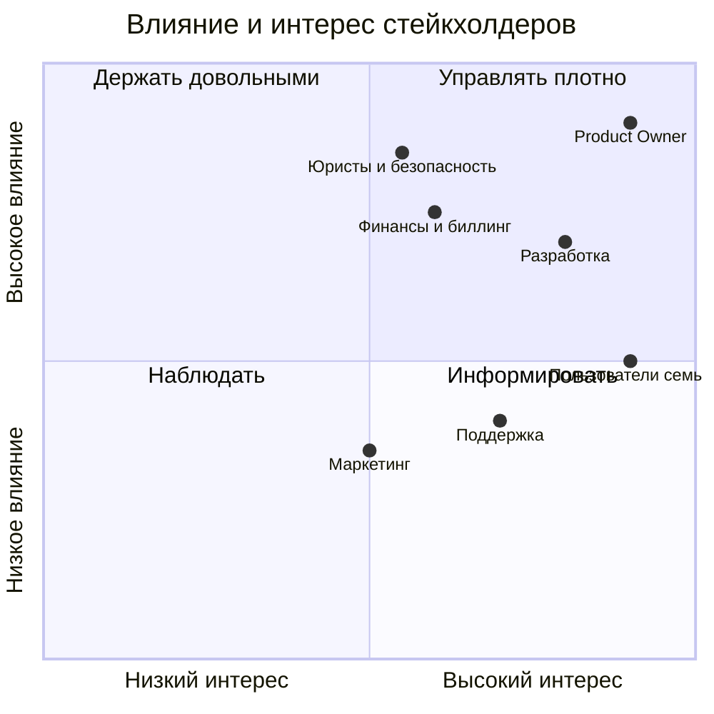

# Стейкхолдеры и персоны: фича «Семейный аккаунт»

## Карта стейкхолдеров

| Стейкхолдер | Роль в проекте | Интерес | Возможное противоречие |
|---|---|---|---|
| Product Owner | Заказчик фичи | Рост частоты заказов и retention | Хочет быстро → давит на объём v1 |
| Пользователи (семьи) | Конечные пользователи | Удобно заказывать всей семьёй, контроль трат | Приватность: не хотят, чтобы всё видели все |
| Поддержка | Внутренний пользователь | Меньше обращений «чужой заказ/оплата» | — |
| Финансы / биллинг | Поставщик решения | Корректность общего кошелька и возвратов | Общий кошелёк усложняет сверку |
| Юристы / безопасность | Контролёр | Соблюдение 152-ФЗ, согласие на обработку данных членов семьи, защита детей | Требуют согласий → усложняют онбординг |
| Разработка | Исполнитель | Реализуемость, понятные требования | Ограничения платёжного провайдера |
| Маркетинг | Заинтересованная сторона | Новый инфоповод, промо «пригласи семью» | — |

## Матрица «влияние / интерес»

## RACI по ключевым работам

| Работа | BA | PO | Разработка | Юристы | Финансы |
|---|---|---|---|---|---|
| Сбор и описание требований | **R** | A | C | C | C |
| Приоритизация v1 | C | **A/R** | C | I | I |
| Модель данных и роли | **R** | A | C | C | I |
| Согласие на обработку данных (152-ФЗ) | C | A | I | **R** | I |
| Логика общего кошелька | C | A | **R** | I | C |
| Приёмка фичи | C | **A** | C | I | I |

> R — исполняет, A — отвечает/утверждает, C — консультируют, I — информируют.

---

## Персоны пользователей

### Персона 1. Ирина, 42 — «глава семьи»
- **Контекст:** работает, заказывает продукты на всю семью 2–3 раза в неделю.
- **Задача (JTBD):** «Когда я занята, я хочу, чтобы муж и сын могли дозаказать нужное на наш общий счёт, но при этом я контролировала траты — чтобы не выходить за бюджет».
- **Боль сейчас:** всё идёт с её телефона и карты; сын не может заказать сам; не видно, кто что добавил.

### Персона 2. Максим, 15 — «подросток»
- **Контекст:** приходит из школы раньше родителей, хочет заказать перекус/продукты к ужину.
- **Задача (JTBD):** «Когда родителей нет дома, я хочу сам заказать продукты в пределах разрешённой суммы, не выпрашивая карту».
- **Боль сейчас:** не может оформить заказ без карты родителей.

### Персона 3. Сергей, 45 — «взрослый участник»
- **Контекст:** муж Ирины, иногда заказывает по дороге с работы.
- **Задача (JTBD):** «Я хочу заказать на общий адрес и общую оплату, не заводя отдельный аккаунт и не дублируя адреса».
- **Боль сейчас:** у него свой аккаунт с другими адресами, оплата врозь, бонусы не копятся вместе.
