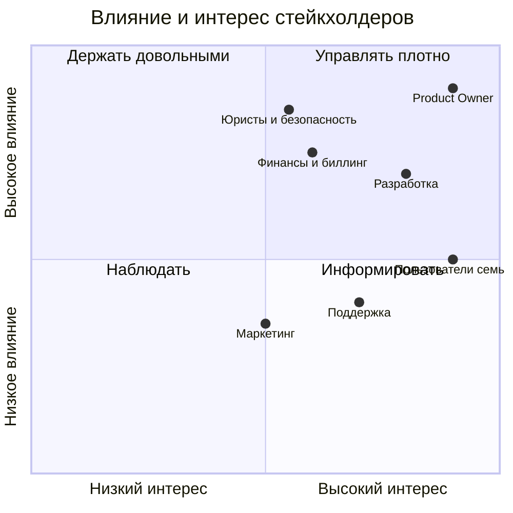

# Стейкхолдеры и персоны: «Семейный аккаунт»

## Карта стейкхолдеров

| Стейкхолдер | Роль в проекте | Интерес | Где может быть конфликт |
|---|---|---|---|
| Product Owner | Заказчик фичи | Рост частоты заказов и retention | Хочет быстро, давит на объём v1 |
| Пользователи (семьи) | Конечные пользователи | Удобно заказывать всей семьёй, контроль трат | Не хотят, чтобы всё видели все |
| Поддержка | Внутренний пользователь | Меньше обращений про чужие заказы и оплату | — |
| Финансы / биллинг | Поставщик решения | Корректный общий кошелёк и возвраты | Общий кошелёк усложняет сверку |
| Юристы / безопасность | Контролёр | 152-ФЗ, согласие на обработку данных членов семьи, защита детей | Требуют согласий, онбординг усложняется |
| Разработка | Исполнитель | Реализуемость, понятные требования | Ограничения платёжного провайдера |
| Маркетинг | Заинтересованная сторона | Инфоповод, промо «пригласи семью» | — |

## Матрица «влияние / интерес»

## RACI по ключевым работам

| Работа | BA | PO | Разработка | Юристы | Финансы |
|---|---|---|---|---|---|
| Сбор и описание требований | **R** | A | C | C | C |
| Приоритизация v1 | C | **A/R** | C | I | I |
| Модель данных и роли | **R** | A | C | C | I |
| Согласие на обработку данных (152-ФЗ) | C | A | I | **R** | I |
| Логика общего кошелька | C | A | **R** | I | C |
| Приёмка фичи | C | **A** | C | I | I |

R — исполняет, A — отвечает и утверждает, C — консультируют, I — информируют.

---

## Персоны

### Ирина, 42 — «глава семьи»
Работает, заказывает продукты на всю семью 2–3 раза в неделю. Её задача: «Когда я занята, хочу, чтобы муж и сын дозаказали нужное на наш общий счёт, но так, чтобы я держала траты в рамках бюджета». Сейчас всё идёт с её телефона и карты, сын не может заказать сам, и не видно, кто что добавил в корзину.

### Максим, 15 — «подросток»
Приходит из школы раньше родителей и хочет заказать перекус или продукты к ужину. Его задача: «Когда родителей нет дома, хочу сам заказать в пределах разрешённой суммы, не выпрашивая карту». Сейчас без карты родителей заказ не оформить.

### Сергей, 45 — «взрослый участник»
Муж Ирины, иногда заказывает по дороге с работы. Его задача: «Хочу заказать на общий адрес и общую оплату, не заводя отдельный аккаунт и не дублируя адреса». Сейчас у него свой аккаунт с другими адресами, оплата врозь, бонусы не копятся вместе.
