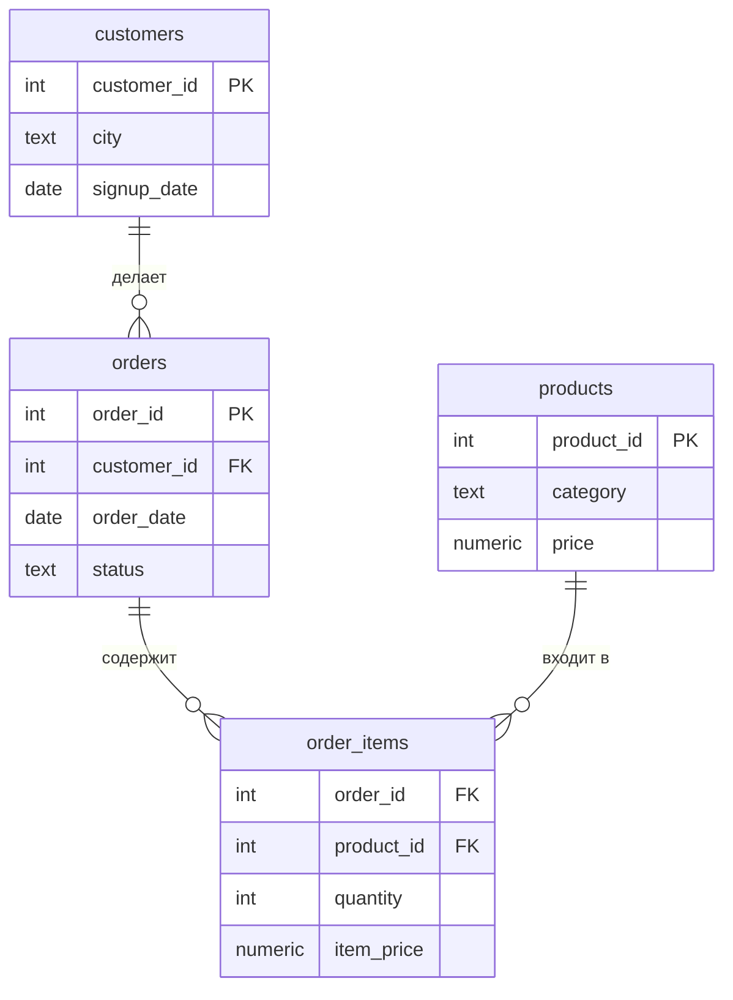

# Кейс 3. SQL-анализ продаж маркетплейса

**Роль:** бизнес-аналитик / аналитик данных · **Домен:** e-commerce · **Что показывает кейс:** умение переводить бизнес-вопросы в SQL, владение JOIN, агрегацией, CTE и оконными функциями, когортным анализом.

---

## Задача

Руководство маркетплейса хочет ответы на вопросы: *где делается выручка, как она растёт, возвращаются ли клиенты и кого удерживать в первую очередь.* Нужно ответить на них на данных, а не на ощущениях.

---

## Данные

Модель «клиенты → заказы → позиции заказа → товары». Чтобы кейс был **самодостаточным и воспроизводимым**, данные не берутся из внешнего файла, а генерируются процедурно в PostgreSQL через `generate_series` с фиксированным `setseed`. Это ~2 000 клиентов, 300 товаров в 10 категориях и ~9 000 заказов за 2 года.



> Если ER-диаграмма выше не отрисовалась — это ограничение рендера Mermaid в вашем просмотрщике; на GitHub она отображается.

---

## Как запустить

Нужен PostgreSQL. Выполнить скрипты по порядку:

```bash
psql -d your_db -f sql/01_schema.sql
psql -d your_db -f sql/02_seed.sql
psql -d your_db -f sql/03_analysis.sql
```

- [`sql/01_schema.sql`](sql/01_schema.sql) — таблицы, ключи, индексы.
- [`sql/02_seed.sql`](sql/02_seed.sql) — генерация синтетических данных.
- [`sql/03_analysis.sql`](sql/03_analysis.sql) — 8 аналитических запросов с комментариями.

---

## Бизнес-вопросы и техники

| # | Бизнес-вопрос | SQL-техника |
|---|---|---|
| Q1 | Какие категории приносят больше всего выручки? | JOIN 3 таблиц, `GROUP BY`, `COUNT DISTINCT` |
| Q2 | Какова доля категории в выручке? | оконные `SUM() OVER ()`, `RANK()` |
| Q3 | Как растёт выручка по месяцам? | CTE, `date_trunc`, `LAG()` (MoM) |
| Q4 | Какая доля клиентов покупает повторно? | `FILTER`, агрегация по клиенту |
| Q5 | Как удерживаются когорты? | когортный анализ, расчёт номера месяца |
| Q6 | Какой уровень оттока? | `MAX(date)`, интервалы, `FILTER` |
| Q7 | Кого удерживать в первую очередь? | RFM через `NTILE(5)` |
| Q8 | Средний чек и выручка на клиента? | вложенная агрегация (AOV, ARPU) |

---

## Выводы

Полная интерпретация результатов — в [`results/findings.md`](results/findings.md). Коротко: запросы выстроены как воронка вопросов коммерческого руководства — **сколько и где зарабатываем → как растём → возвращаются ли клиенты → кого беречь**.

---

## Стек

`PostgreSQL` · `SQL (JOIN, GROUP BY, CTE, window functions, NTILE, LAG, RANK)` · когортный анализ · RFM
