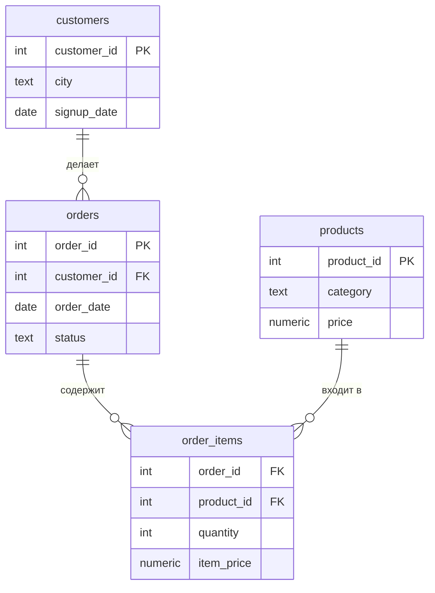

# Кейс 3. SQL-анализ продаж маркетплейса

Домен: e-commerce. Здесь я перевожу бизнес-вопросы в SQL — с JOIN, агрегацией, CTE, оконными функциями и когортным анализом.

---

## Задача

Руководство маркетплейса хочет понять по данным, а не по ощущениям: где делается выручка, как она растёт, возвращаются ли клиенты и кого удерживать в первую очередь.

---

## Данные

Модель простая: клиенты → заказы → позиции заказа → товары. Чтобы кейс можно было запустить у себя и получить тот же результат, данные не лежат во внешнем файле, а генерируются в PostgreSQL через `generate_series` с фиксированным `setseed`. Получается около 2 000 клиентов, 300 товаров в 10 категориях и примерно 9 000 заказов за два года.



Если ER-диаграмма не нарисовалась, значит просмотрщик не умеет в Mermaid. На GitHub она отображается.

---

## Как запустить

Нужен PostgreSQL. Скрипты по порядку:

```bash
psql -d your_db -f sql/01_schema.sql
psql -d your_db -f sql/02_seed.sql
psql -d your_db -f sql/03_analysis.sql
```

- [`sql/01_schema.sql`](sql/01_schema.sql) — таблицы, ключи, индексы.
- [`sql/02_seed.sql`](sql/02_seed.sql) — генерация данных.
- [`sql/03_analysis.sql`](sql/03_analysis.sql) — 8 запросов с комментариями.

---

## Вопросы и техники

| # | Вопрос | Техника |
|---|---|---|
| Q1 | Какие категории приносят больше всего выручки? | JOIN 3 таблиц, `GROUP BY`, `COUNT DISTINCT` |
| Q2 | Какова доля категории в выручке? | оконные `SUM() OVER ()`, `RANK()` |
| Q3 | Как растёт выручка по месяцам? | CTE, `date_trunc`, `LAG()` (MoM) |
| Q4 | Какая доля клиентов покупает повторно? | `FILTER`, агрегация по клиенту |
| Q5 | Как удерживаются когорты? | когортный анализ, расчёт номера месяца |
| Q6 | Какой уровень оттока? | `MAX(date)`, интервалы, `FILTER` |
| Q7 | Кого удерживать в первую очередь? | RFM через `NTILE(5)` |
| Q8 | Средний чек и выручка на клиента? | вложенная агрегация (AOV, ARPU) |

---

## Выводы

Разбор результатов — в [`results/findings.md`](results/findings.md). Если коротко, запросы идут воронкой вопросов коммерческого руководства: сколько и где зарабатываем, как растём, возвращаются ли клиенты и кого беречь.

---

## Стек

`PostgreSQL` · `SQL (JOIN, GROUP BY, CTE, window functions, NTILE, LAG, RANK)` · когортный анализ · RFM
