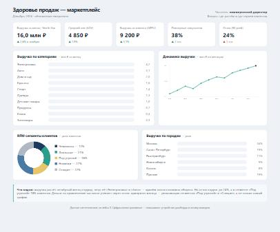
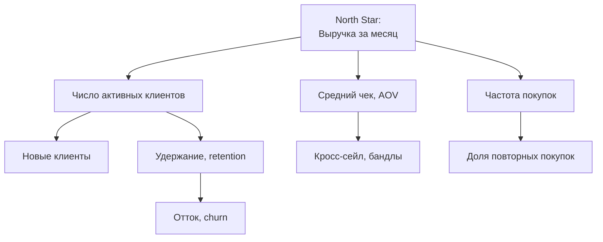

# Кейс 4. Дашборд с бизнес-метриками

Домен: e-commerce. Здесь я собираю дашборд на данных из [кейса 3](../project-3-sql-analysis/) — не ради «красивых цифр», а чтобы он отвечал на вопрос конкретного человека.

---

## Задача

Коммерческому директору маркетплейса нужен один экран, по которому видно здоровье продаж: где растём, где теряем клиентов и за что браться в этом месяце. Дашборд собирается под него и под его вопросы.

---

## Превью

Интерактивный макет — [`dashboard/index.html`](dashboard/index.html). Файл самодостаточный (без внешних зависимостей), открывается в браузере. Чтобы получить публичную ссылку, его можно отдать в GitHub Pages: включить Pages в настройках репозитория и вставить сюда адрес вида `https://xenam006.github.io/resume/...`. В реальном проекте на его месте был бы дашборд в Power BI, Tableau Public или Yandex DataLens.

> **Публичная версия:** _[вставьте ссылку после публикации в DataLens / Power BI / GitHub Pages]_

---

## Дерево метрик

Прежде чем рисовать тайлы, я раскладываю North Star на то, из чего он складывается. Так на дашборде оказывается не всё подряд, а показатели, на которые реально можно влиять.

---

## Что на дашборде

Верхняя строка — пять KPI: выручка за месяц (это North Star), средний чек, выручка на клиента, доля повторных покупателей и отток. У каждого показана динамика к прошлому месяцу, чтобы было видно направление, а не только текущее число.

Ниже — выручка по категориям и помесячная динамика: первый отвечает «где делаются деньги», второй «куда движемся». Ещё ниже — RFM-сегменты клиентов и выручка по городам.

Внизу — вывод словами: что происходит и что с этим делать. На макете это выглядит так: выручка растёт четвёртый месяц, тянут её «Электроника» и «Авто», но отток подрос до 24%, поэтому приоритет месяца — реактивация сегментов «Под угрозой» и «Спящие», а не только новый трафик.

---

## Откуда берутся цифры

Каждый тайл считается из схемы кейса 3 (клиенты, заказы, позиции, товары). Запросы собраны в [`sql/dashboard_queries.sql`](sql/dashboard_queries.sql): KPI, выручка по категориям и городам, помесячная динамика, RFM-сегменты. В BI-системе эти запросы становятся источниками данных для тайлов.

Цифры на макете иллюстративные — они показывают устройство дашборда и логику выводов. Реальные значения получаются запуском запросов на данных кейса 3.

---

## Стек

`Дерево метрик` · `North Star` · `BI-тайлы под читателя` · `SQL (источники данных)` · `Power BI / Tableau / Yandex DataLens`
