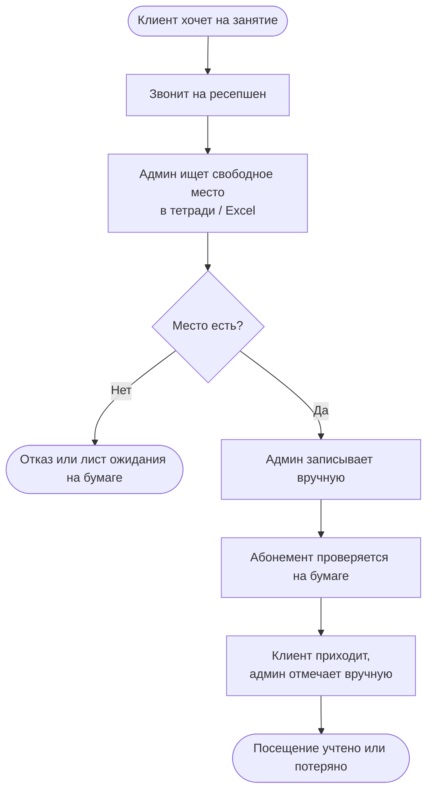
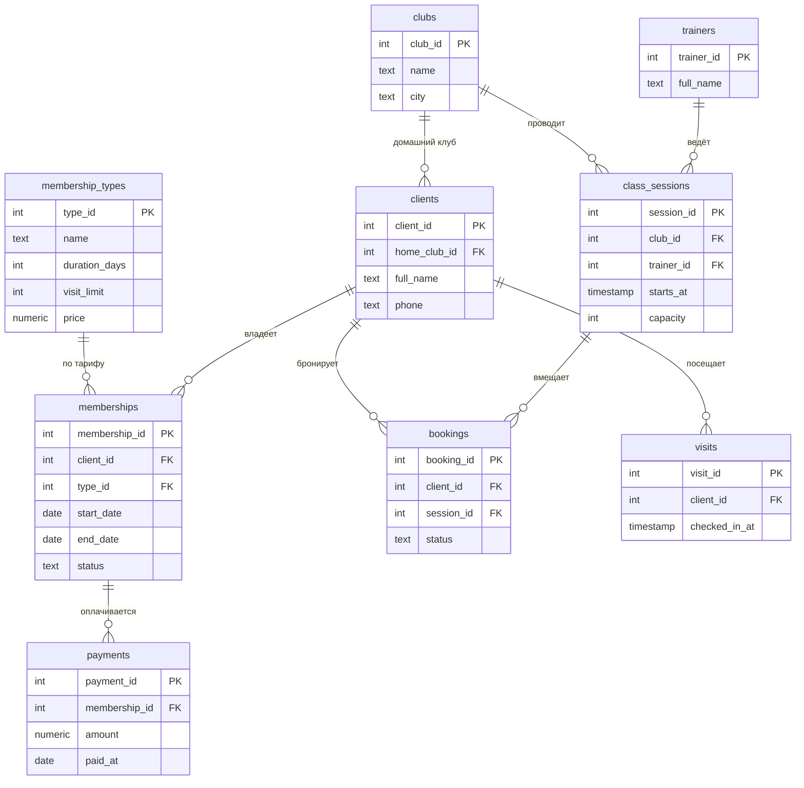

# Кейс 6 (флагман). CRM для сети фитнес-клубов «под ключ»

**Роль:** бизнес-аналитик · **Домен:** фитнес / услуги · **Что показывает кейс:** полный цикл работы аналитика — от анализа домена и процессов до требований, модели данных, API и бизнес-обоснования. Это проект «от идеи до передачи в разработку».

---

## Бизнес-контекст и проблема

Сеть фитнес-клубов «ФитПро» (условная) — 5 клубов. Учёт клиентов, абонементов, расписания групповых тренировок и записей ведётся в **Excel и бумажных тетрадях на ресепшене**. Каждый клуб живёт по-своему.

Что болит:

- **Нет единой базы клиентов и абонементов.** Непонятно, у кого когда заканчивается абонемент → теряются продления.
- **Запись на групповые занятия — по телефону и в тетради.** Двойные записи, неявки, тренер не видит, кто придёт.
- **Абонементы и заморозки — «на бумаге».** Споры с клиентами, злоупотребления.
- **Нет аналитики.** Руководство не видит посещаемость, загрузку залов, конверсию в продления.

**Задача аналитика:** проанализировать домен, описать процессы AS-IS/TO-BE, собрать требования, спроектировать модель данных и API, обосновать проект экономически и передать это в разработку.

---

## Содержание кейса

| Раздел | Документ |
|---|---|
| Стейкхолдеры, RACI, персоны | [docs/stakeholders.md](docs/stakeholders.md) |
| Требования: BRD, функциональные, нефункциональные, user stories, MoSCoW | [docs/requirements.md](docs/requirements.md) |
| Сценарии использования | [docs/use-cases.md](docs/use-cases.md) |
| Глоссарий | [docs/glossary.md](docs/glossary.md) |
| Бизнес-кейс и расчёт ROI | [docs/business-case.md](docs/business-case.md) |
| Процессы AS-IS / TO-BE (BPMN) | [diagrams/as-is.bpmn](diagrams/as-is.bpmn) · [diagrams/to-be.bpmn](diagrams/to-be.bpmn) |
| Модель данных + DDL (PostgreSQL) | [sql/schema.sql](sql/schema.sql) |
| Описание API (OpenAPI 3.0) | [api/openapi.yaml](api/openapi.yaml) |

---

## Процесс «Запись на групповое занятие»

### AS-IS (как есть)

### TO-BE (как должно быть)

**Ключевые изменения:** самозапись онлайн вместо звонков, автопроверка абонемента и мест, автонапоминания против неявок, check-in по QR и единый учёт посещений, у тренера — актуальный список.

---

## Модель данных (обзор)

Полная DDL со всеми ограничениями — в [sql/schema.sql](sql/schema.sql).

---

## Экономика проекта (кратко)

Подробный расчёт — в [docs/business-case.md](docs/business-case.md).

| Показатель | Значение |
|---|---|
| Разовые затраты на внедрение | ~1,2 млн ₽ |
| Годовой эффект (продления + экономия времени + меньше неявок) | ~3,0 млн ₽ |
| Срок окупаемости | **~5 месяцев** |
| ROI за первый год | **~150%** |

---

## Карта требований (MoSCoW, кратко)

| Must | Should | Could | Won't (v1) |
|---|---|---|---|
| Единая база клиентов и абонементов, расписание и онлайн-запись, учёт посещений, продажи/продления | Автонапоминания о неявке и окончании абонемента, заморозка абонемента, дашборд загрузки | Программа лояльности, мобильное приложение клиента | Интеграция с турникетами по всей сети, биометрия |

Полная версия с обоснованием — в [docs/requirements.md](docs/requirements.md).

---

## Стек и ход работы

`Анализ домена` · `BPMN 2.0` · `BRD + user stories (INVEST)` · `UML` · `ER-моделирование` · `SQL (PostgreSQL DDL)` · `OpenAPI 3.0` · `Бизнес-кейс (ROI, срок окупаемости)`

**Как я вёл проект:** изучил домен и стейкхолдеров → описал процессы AS-IS и нашёл потери → спроектировал TO-BE → собрал и приоритизировал требования → построил модель данных под требования → описал контракт API для разработки → обосновал проект экономически и собрал всё в единый передаваемый пакет.
