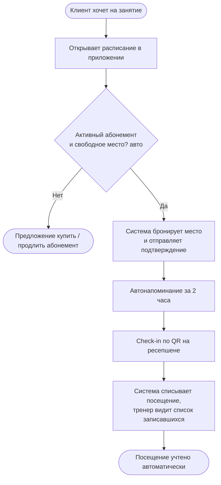
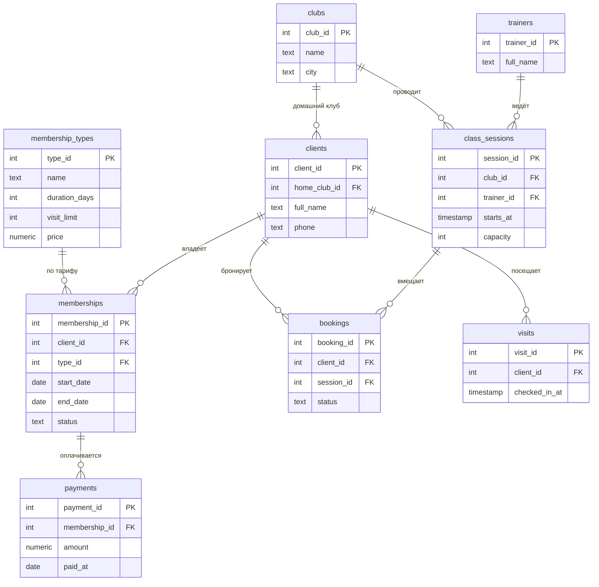

# Кейс 6 (флагман). CRM для сети фитнес-клубов «под ключ»

Домен: фитнес и услуги. Самый большой кейс: от анализа домена и процессов до требований, модели данных, API и расчёта экономики. Проект от идеи до передачи в разработку.

---

## С чего всё началось

Сеть фитнес-клубов «ФитПро» (условная) — пять клубов. Клиенты, абонементы, расписание групповых тренировок и записи живут в Excel и бумажных тетрадях на ресепшене, и каждый клуб ведёт их по-своему.

Что болит:

- Нет единой базы клиентов и абонементов. Непонятно, у кого когда кончается абонемент, и продления теряются.
- Запись на занятия идёт по телефону и в тетрадь. Отсюда двойные записи, неявки, и тренер не знает, кто придёт.
- Абонементы и заморозки «на бумаге» — споры с клиентами и поле для злоупотреблений.
- Аналитики нет. Руководство не видит ни посещаемости, ни загрузки залов, ни того, сколько клиентов продлевается.

Моя задача: разобрать домен, описать процессы как есть и как должно быть, собрать требования, спроектировать модель данных и API, обосновать проект деньгами и передать всё в разработку.

---

## Содержание кейса

| Раздел | Документ |
|---|---|
| Стейкхолдеры, RACI, персоны | [docs/stakeholders.md](docs/stakeholders.md) |
| Требования: BRD, функциональные, нефункциональные, user stories, MoSCoW | [docs/requirements.md](docs/requirements.md) |
| Сценарии использования | [docs/use-cases.md](docs/use-cases.md) |
| Глоссарий | [docs/glossary.md](docs/glossary.md) |
| Бизнес-кейс и расчёт ROI | [docs/business-case.md](docs/business-case.md) |
| Процессы AS-IS / TO-BE (BPMN) | [diagrams/as-is.bpmn](diagrams/as-is.bpmn) · [diagrams/to-be.bpmn](diagrams/to-be.bpmn) |
| Модель данных + DDL (PostgreSQL) | [sql/schema.sql](sql/schema.sql) |
| Описание API (OpenAPI 3.0) | [api/openapi.yaml](api/openapi.yaml) |

---

## Процесс «Запись на групповое занятие»

### Как есть (AS-IS)

### Как должно быть (TO-BE)

Главное, что меняется: клиент записывается сам онлайн вместо звонков, абонемент и места проверяет система, автонапоминания снижают неявки, приход отмечается по QR и попадает в единый учёт, а у тренера всегда актуальный список.

---

## Модель данных (обзор)

Полная DDL со всеми ограничениями — в [sql/schema.sql](sql/schema.sql).

---

## Экономика проекта (кратко)

Полный расчёт — в [docs/business-case.md](docs/business-case.md).

| Показатель | Значение |
|---|---|
| Разовые затраты на внедрение | ~1,2 млн ₽ |
| Годовой эффект (продления + экономия времени + меньше неявок) | ~3,0 млн ₽ |
| Срок окупаемости | ~5 месяцев |
| ROI за первый год | ~150% |

---

## Что входит в первую версию (MoSCoW, кратко)

| Must | Should | Could | Won't (v1) |
|---|---|---|---|
| Единая база клиентов и абонементов, расписание и онлайн-запись, учёт посещений, продажи/продления | Напоминания о неявке и окончании абонемента, заморозка, дашборд загрузки | Программа лояльности, мобильное приложение клиента | Турникеты по всей сети, биометрия |

Полная версия с обоснованием — в [docs/requirements.md](docs/requirements.md).

---

## Стек

`Анализ домена` · `BPMN 2.0` · `BRD + user stories (INVEST)` · `UML` · `ER-моделирование` · `SQL (PostgreSQL DDL)` · `OpenAPI 3.0` · `Бизнес-кейс (ROI, срок окупаемости)`

Я изучил домен и стейкхолдеров, описал процессы как есть и нашёл, где теряются деньги, спроектировал новый процесс, собрал и приоритизировал требования. Под эти требования построил модель данных, описал контракт API для разработки, обосновал проект экономикой и собрал всё в один передаваемый пакет.
