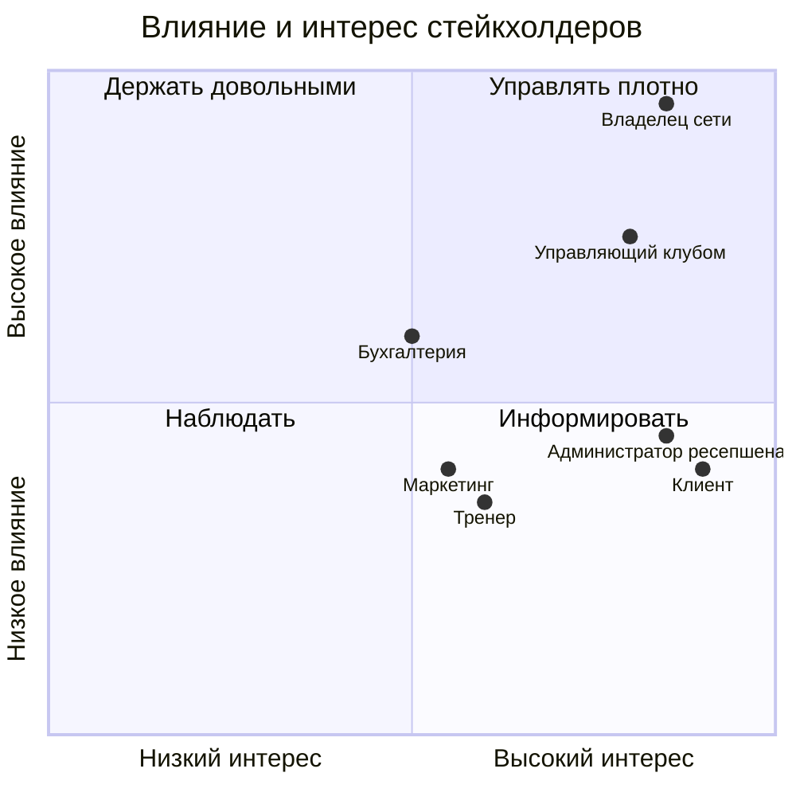

# Стейкхолдеры и персоны: CRM для сети фитнес-клубов

## Карта стейкхолдеров

| Стейкхолдер | Роль | Интерес | Где трение |
|---|---|---|---|
| Владелец сети | Спонсор проекта | Выручка, прозрачность, управляемость | Хочет быстрый результат при ограниченном бюджете |
| Управляющий клубом | Ключевой пользователь | Загрузка залов, план продлений | Боится, что система усложнит работу |
| Администратор ресепшена | Основной оператор | Быстро записать, продать, отметить приход | Привык к тетради, будет сопротивляться |
| Тренер | Пользователь | Видеть, кто придёт на занятие | Не хочет лишней бюрократии |
| Клиент | Конечный пользователь | Легко записаться, видеть абонемент, не стоять в очереди | Приватность данных |
| Бухгалтерия | Поставщик требований | Корректный учёт оплат и возвратов | — |
| Маркетинг | Заинтересованная сторона | Сегменты для акций, напоминания о продлении | — |
| ИТ / подрядчик | Исполнитель | Реализуемость, понятный контракт API | Сроки интеграций |

## Матрица «влияние / интерес»

## RACI по ключевым работам

| Работа | BA | Владелец | Управляющий | ИТ-подрядчик | Бухгалтерия |
|---|---|---|---|---|---|
| Анализ домена и процессов | **R** | A | C | I | C |
| Требования и приоритизация | **R** | A | C | C | C |
| Модель данных и API | **R** | A | I | C | C |
| Бизнес-кейс / ROI | **R** | **A** | C | I | C |
| Учёт оплат и возвратов | C | A | I | C | **R** |
| Приёмка системы | C | **A** | R | C | I |

R — исполняет, A — отвечает и утверждает, C — консультируют, I — информируют.

---

## Персоны

### Ольга, 34 — администратор ресепшена
Принимает больше сотни обращений в день: продаёт и продлевает абонементы, записывает на занятия. Её задача: «Когда клиент у стойки или на телефоне, хочу за секунды увидеть его абонемент и свободные места, а не копаться в тетрадях и собирать очередь». Сейчас это тетради, Excel, двойные записи и споры про заморозку.

### Дмитрий, 40 — управляющий клубом
Отвечает за выручку и загрузку клуба. Его задача: «Хочу видеть, у кого кончается абонемент и какая загрузка залов, чтобы вовремя продлевать и крутить расписание». Сейчас данных нет, планирует на глаз.

### Анна, 28 — клиент
Ходит на групповые 2–3 раза в неделю. Её задача: «Хочу сама записаться на удобное занятие и видеть, сколько осталось по абонементу, не звоня на ресепшен». Сейчас записаться можно только по телефону в рабочие часы, и непонятно, когда абонемент закончится.
